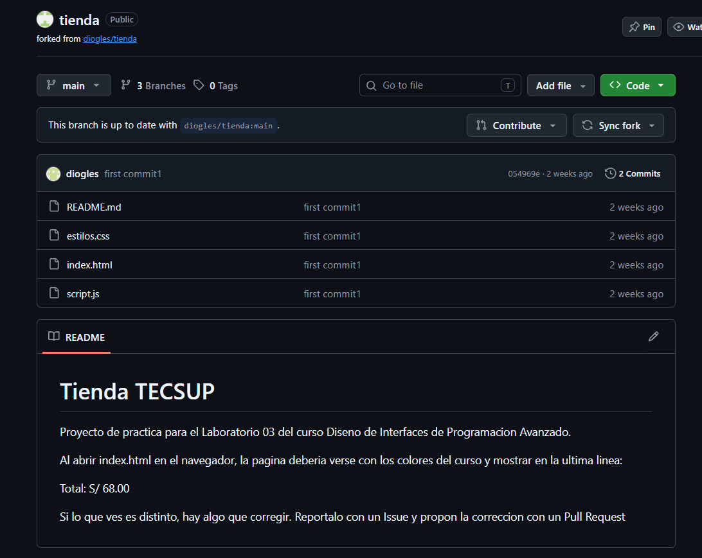

# TRABAJO COLABORATIVO CON REPOSITORIOS REMOTOS

## Procesos

1. Se copia un repositorio de Github a nuestra cuenta utilizando *fork*.
2. Se ubico el error y se le notifico al propietario del repositorio utilizando *issue*.
3. Descargar el repositorio a nuestra computadora utilizando *clone*. 
4. Realizar la corrección y subir los cambios al repositorio. 
5. Realiza un pull-request al dueño del proyecto y cerrar el issue.

### Puntos a tomar en cuenta:
- Al realizar el issue, indicar cuatro puntos: Que se esperaba, que ocurre, en donde ocurre y como reproducirlo.
- En el mensaje del commit, para solucionar el error, indicar el numero del issue, asi mismo al momento de realizar el pull-request.

## Herramientas de Github utilizadas

- [x] Fork
- [x] Issue
- [x] Pull-request

## Comandos utilizados 
Los comandos nuevos utilizados son los siguientes:

```bash 
git clone url...
git diff
git push origin url....

```

| Comando | Que hace |
|---------|----------|
| git clone | Descarga el repositorio a nuestra computadora |
| git diff | Nos permite ver los cambios implementados |
| git push | Sube los cambios al remoto |
 
> Es importante usar el git diff antes de realizar el pull-request para poder verificar si lo que mandamos es lo correcto.

## Enlaces

- [Mi perfil de GitHub](https://github.com/TU-USUARIO)

## Captura del repositorio

